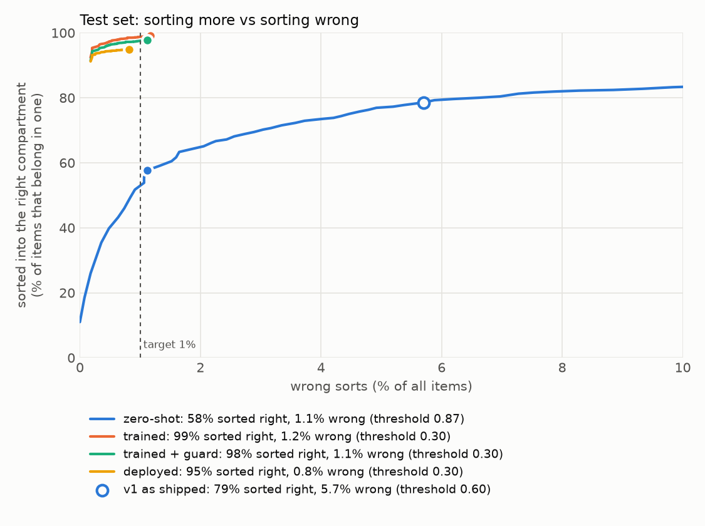

# BinSight v2

A campus smart bin. An item goes on a tray, a camera classifies it, and the tray drops it into
PLASTIC, PAPER, METAL or ORGANIC. Anything uncertain or out of scope goes to UNSURE for manual
sorting, because one wrong item contaminates a whole compartment: a wrong auto-sort is much worse
than an UNSURE.

v1 asked a pretrained model (SigLIP2) to match photos against text prompts. v2 trains its own
classifier on ~25k public waste photos on top of that model, calibrates it, and picks the UNSURE
threshold from data to keep wrong sorts under 1%. See **[reports/REPORT.md](reports/REPORT.md)**
for the measured accuracy against v1.

## Results

On 3,945 held-out test photos (never used for training, tuning or picking the threshold):

| | v1 zero-shot | v2 deployed |
| --- | --- | --- |
| 5-class accuracy | 82.5% | **98.7%** |
| Items put in the wrong compartment | 5.7% | **0.8%** |
| Sortable items sorted into the right compartment | 78.6% | **95.0%** |
| Wrong items in the ORGANIC bin | 19.9% | **0** |
| Wrong sorts on real rubbish photos it never trained on (RealWaste held out) | 7.9% | **3.1%** |
| Wrong sorts on soft plastics it never trained on (recycling-dataset held out) | 4.1% | **1.8%** |
| Latency per item (M5, fp16) | ~90 ms (fp32) | ~34 ms |

The test set includes real rubbish photographed at a recycling facility (RealWaste), which is
harder than studio photos, so these numbers are lower than earlier versions of this table.

v2 only auto-sorts when its trained head and the zero-shot prompts agree, unless the head is at
least 99% sure. ORGANIC is stricter: zero-shot must always agree and the head needs 98%
confidence, because glass or plastic in food waste can hurt animals.



These are web photos, so expect lower numbers from a real webcam; the full write-up and its
limitations are in [reports/REPORT.md](reports/REPORT.md).

Why the guard matters: on a photo of an open hand, the trained head alone says *organic, 0.73*,
because the training data has no hands, and that is above the threshold. The zero-shot guard
scores it *other, 0.99* and it goes to UNSURE instead.

## How it works

```
webcam crop ──► SigLIP2 vision encoder (frozen, open source) ──► 1152-d embedding
                                                                   │
                         ┌─────────────────────────────────────────┤
                         ▼                                         ▼
              trained head (this repo)                 zero-shot prompts (v1)
              plastic/paper/metal/organic/other        "is it a hand, a face, ...?"
                         │                                         │
                         └──────────► route ◄──────────────────────┘
               UNSURE if top class is "other", confidence < threshold,
               the zero-shot guard says "other", or the two disagree
               (and the head is under 99% sure);
               otherwise that compartment
```

- **Backbone**: `google/siglip2-so400m-patch16-256`, frozen. Only the head's weights are
  trained. With about 20k images, a frozen strong encoder generalises better than fine-tuning
  400M parameters, and it keeps the zero-shot prompts working as a guard for things the datasets
  have no pictures of (hands, faces, an empty tray).
- **Agreement**: an item is auto-sorted only if the trained head and the zero-shot prompts pick
  the same class, or the head is at least 99% sure (`agreement` in `config.yaml`).
- **Head**: linear or one-hidden-layer MLP, picked by a small grid on validation macro-F1;
  class-balanced loss; label smoothing; temperature-calibrated softmax.
- **Data**: four openly licensed Hugging Face datasets (MIT / Apache-2.0 / CC BY 4.0), labels mapped to the
  five classes in `config.yaml`, near-duplicates merged before splitting so nothing leaks from
  train to test, 70/15/15 stratified split, two augmented views per training image.

## Setup

Needs [uv](https://docs.astral.sh/uv/) and about 10 GB of disk for the model and datasets.

```bash
uv sync
```

The trained head is committed in `models/`, so `live` and `classify` work straight away. To
rebuild everything from the public data:

```bash
uv run binsight prepare    # download datasets, embed, de-duplicate, split (~35 min on an M5)
uv run binsight train      # train the head, calibrate, pick the threshold (~ a few minutes)
uv run binsight crosscheck # harder test: leave each dataset out in turn
uv run binsight evaluate   # held-out test results -> reports/REPORT.md
```

`prepare` caches its work in `data/` and can be re-run.

### Camera access

macOS only lets an app use the camera if you allow it. Allow the terminal app you run
`binsight` from in **System Settings → Privacy & Security → Camera**, then restart that app.
If a phone nearby takes over camera 0 (Continuity Camera), use `--camera 1`.

## Commands

```bash
uv run binsight live                  # webcam demo
uv run binsight classify a.jpg b.jpg  # scores and decision for image files
```

Options for both: `--threshold <0-1>` (default: the value `train` chose), `--zero-shot` (ignore
the trained head, i.e. v1 behaviour), `--model <hf id>` (or `--model fallback` for CLIP; a head
trained on a different backbone is ignored), `--config <path>`. `live` also takes
`--camera <index>`.

### `binsight live`

Hold an item inside the white square (the tray). With the tray empty at start, the app grabs a
background; when the square differs from it and the item stays still for about 10 frames, it
classifies once, shows the result, slides a block to the chosen compartment, and re-arms when you
take the item away. The display is mirrored; the classified crop is not, so label text stays
readable. Nothing is written to disk. Each decision is also printed in the terminal.

| Key | Action |
| --- | --- |
| `SPACE` | classify the tray now |
| `B` | re-capture the empty-tray background (do this if lighting changes) |
| `+` / `-` | raise / lower the UNSURE threshold by 0.05 |
| `Q` / `Esc` | quit |

The hint under the tray shows how much of it differs from the background; near 0% means empty.

## Configuration

Everything is in [`config.yaml`](config.yaml): backbone, head path, prompts, threshold, guard,
dataset label mapping, split and training settings, ROI size, trigger sensitivity and colours.

## Development

```bash
uv run ruff format . && uv run ruff check .
```

## License and credits

BinSight's code and trained head (`models/`) are released under the [MIT License](LICENSE).

It builds on others' work, each under its own license:

| What | Used for | License |
| --- | --- | --- |
| [google/siglip2-so400m-patch16-256](https://huggingface.co/google/siglip2-so400m-patch16-256) | frozen image/text encoder, downloaded at first run (not redistributed here) | Apache-2.0 |
| [openai/clip-vit-large-patch14](https://huggingface.co/openai/clip-vit-large-patch14) | optional fallback encoder | MIT |
| [omasteam/waste-garbage-management-dataset](https://huggingface.co/datasets/omasteam/waste-garbage-management-dataset) | training and test images | MIT |
| [garythung/trashnet](https://huggingface.co/datasets/garythung/trashnet) | training and test images | MIT |
| [viola77data/recycling-dataset](https://huggingface.co/datasets/viola77data/recycling-dataset) | training and test images | Apache-2.0 |
| [Tatyr2210/waste-classification-vit](https://huggingface.co/datasets/Tatyr2210/waste-classification-vit), which appears to be [RealWaste](https://archive.ics.uci.edu/dataset/908/realwaste) (Single, Iranmanesh & Raad, 2023) | training and test images (real rubbish at a recycling facility) | MIT (upload); RealWaste is CC BY 4.0 |

The datasets are downloaded by `binsight prepare` and are not included in this repository.
