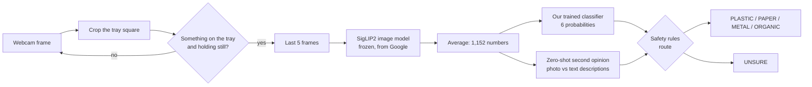

# How BinSight works: a code walkthrough

This explains every part of BinSight in plain language, with links to the code, so you can
answer questions about it. Read it top to bottom once (about 15 minutes); after that the
[questions section](#questions-you-might-get) and the [glossary](#glossary) work as a cheat
sheet.

## The 30-second version

> BinSight is a camera-based smart bin. You put an item on the tray; the camera takes a few
> frames, and a free, open-source image model from Google turns them into a list of 1,152
> numbers that describe what it sees. A small classifier we trained on about 28,000 public
> waste photos reads those numbers and picks plastic, paper, metal, organic, glass or other.
> Safety rules then decide whether it is sure enough to sort; anything doubtful goes to an
> UNSURE compartment for a person, because one wrong item spoils a whole compartment. On 5,984
> test photos it never trained on, 0.5% of items went into a wrong compartment, and nothing
> wrong reached ORGANIC.

## Map of the code

Everything lives in [`src/binsight/`](../src/binsight); every setting lives in
[`config.yaml`](../config.yaml).

| File | Lines | What it does |
| --- | --- | --- |
| [`cli.py`](../src/binsight/cli.py) | ~140 | The `binsight` command: `prepare`, `train`, `crosscheck`, `evaluate`, `live`, `classify` |
| [`config.py`](../src/binsight/config.py) | ~130 | Reads `config.yaml` into typed settings |
| [`model.py`](../src/binsight/model.py) | ~290 | The image model, the trained classifier, and the safety rules (`route`) |
| [`data.py`](../src/binsight/data.py) | ~315 | Downloads the datasets, turns photos into numbers, removes duplicates, splits train/val/test |
| [`train.py`](../src/binsight/train.py) | ~150 | Trains the classifier, calibrates it, picks the UNSURE threshold |
| [`metrics.py`](../src/binsight/metrics.py) | ~90 | Accuracy, wrong-sort rate and the other scores |
| [`evaluate.py`](../src/binsight/evaluate.py) | ~480 | Runs the final test and writes [`reports/REPORT.md`](../reports/REPORT.md) and the charts |
| [`crosscheck.py`](../src/binsight/crosscheck.py) | ~80 | The tougher test: leave a whole dataset out, test on it |
| [`live.py`](../src/binsight/live.py) | ~490 | The webcam demo: tray detection, frame vote, second look, display |
| [`space/app.py`](../space/app.py) | ~130 | The browser demo (one photo at a time) |

About 2,300 lines of Python in total.

## 1. One item, start to finish

This is what happens in `binsight live` when you put a can on the tray.

**Step 1: crop the tray.** The window shows a white square: that is the tray.
`LiveApp.crop` cuts that square out of the camera frame. The screen is mirrored (like a selfie
camera) so it feels natural, but the model gets the *unmirrored* crop so text on labels reads
the right way round.

**Step 2: is there an item, and is it still?** The `Trigger` class in `live.py` is a small
state machine (a set of modes with rules for switching between them):

| State | Meaning | Moves on when |
| --- | --- | --- |
| CAPTURING | Taking a picture of the empty tray (the "background") | 10 frames averaged |
| ARMED | Waiting for an item | more than 4% of the tray differs from the background |
| SETTLING | Item arriving, waiting for it to stop moving | 10 frames in a row with almost no motion: **classify** |
| HELD | Decision shown | tray empty again for 10 frames: back to ARMED |
| TURN | Asked you to turn the item (see step 6) | item moved, then still again: **classify again** |

To compare frames it shrinks the tray to 96 × 96 pixels, blurs it, and compares colours. It
uses colour, not greyscale, because an orange item on a beige tray has almost the same
brightness and would be missed. It also subtracts the image's median colour, so a cloud
passing or the camera adjusting its exposure doesn't look like an item. If the lighting slowly
changes, the background slowly follows it (`adapt_rate`).

**Step 3: the 5-frame vote.** The app keeps the last 5 tray crops in memory (never on disk).
`LiveApp.decide` sends all 5 to the model and averages the results into one decision, so a
single blurry frame or a flash of glare can't decide alone. This takes about 135 ms on a
MacBook (M5).

**Step 4: the image model turns pixels into numbers.** `Backbone.embed_images` in `model.py`
runs [SigLIP2](https://huggingface.co/google/siglip2-so400m-patch16-256), an open-source model
Google trained on billions of image-caption pairs. It turns any photo into an **embedding**: a
list of 1,152 numbers that describes what is in it. Photos of similar things get similar
numbers. Think of it as GPS coordinates for meaning: every can lands in roughly the same
"neighbourhood", far from bananas. We never change this model's weights; it is used as-is
("frozen").

**Step 5: our classifier reads the numbers.** The `Head` class is the part we trained. It takes
the 1,152 numbers and outputs six probabilities that add up to 100%, for example
*metal 99%, plastic 0.4%, ...*. More on how it was trained in [section 4](#4-training-the-classifier-trainpy).

**Step 6: the safety rules decide.** `route` in `model.py` (about 25 lines; worth reading) turns
the probabilities into a compartment or UNSURE. See [section 2](#2-the-safety-rules-route).
If the answer is UNSURE because it was *doubtful* (not confident enough, or the two models
disagree), the app asks you to **turn the item and hold it still** for up to 6 seconds, then
decides again from both looks combined (`Pending` and the TURN state). If it is UNSURE because
the item clearly has no bin (glass, a battery, clothes), it skips that and says UNSURE straight
away.

**Step 7: show it.** The tray slides to the compartment on screen, the side panel counts items
per compartment, and the terminal prints one line per decision. Nothing is saved.

**Keys:** SPACE classifies right now, B re-captures the empty-tray background, + / - change the
threshold, Q quits. After each background capture, `tray_check` looks at the empty tray and
shows tips if it is too dark, too busy (patterned), or unevenly lit, because the model learned
from plain, evenly lit photos.

## 2. The safety rules (`route`)

A wrong sort is much worse than UNSURE: one glass shard in food waste can hurt animals that eat
it, and one wrong item can make a whole recycling batch rejected. So the classifier's top
answer is only the *starting point*. `route` checks these in order and stops at the first one
that says UNSURE:

| # | Rule | Why |
| --- | --- | --- |
| 1 | Top class is **glass** or **other** → UNSURE | There is no glass compartment, and "other" (batteries, clothes, shoes, hands) has no bin |
| 2 | Confidence below the **threshold** (0.30) → UNSURE | Not sure at all |
| 3 | **ORGANIC needs 98%** confidence | The strictest bin: anything wrong in food waste can harm animals |
| 4 | **Zero-shot guard**: the second model gives glass + other 50% or more → UNSURE | Catches things our training photos never showed, like hands, faces or an empty tray |
| 5 | **Second opinion**: if the item might be organic, might be glass (glass ≥ 2%), or the classifier is under 95% sure, the second model must pick the same class | Two independent judgements agreeing is much safer than one |
| — | Otherwise → that compartment | |

**What is the "second model"?** It is the same SigLIP2, used a different way, called
**zero-shot**: it compares the photo's numbers with the numbers for text like *"This is a photo
of a banana peel."* (the prompts are in `config.yaml`). Whichever class's descriptions match
best wins. This was the whole of BinSight v1. It knows about things our datasets don't contain
(hands, phones, faces), which is why it makes a good guard. It is less accurate on rubbish
than our classifier (87.8% vs 98.6%), so it only gets a veto, not the deciding vote.

**Why is the threshold so low (0.30)?** `train.py` picks it automatically: the lowest threshold
(so the most items get sorted) at which the wrong-sort rate on the validation photos stays
under 1%. With rules 3 to 5 doing most of the safety work, 0.30 already meets that target (0.52%
on validation).

**Rule 5 was a choice.** Checking only possible glass/organic sorted a few more items, but on
whole datasets the model had never seen it made four times as many wrong sorts. Adding "or
under 95% sure" kept wrong sorts low. The comparison is in
[`scripts/rule_ab.py`](../scripts/rule_ab.py).

## 3. The training data (`data.py`)

**Sources.** Five free datasets from Hugging Face (MIT, Apache-2.0 and CC BY 4.0 licences), all
listed in `config.yaml` under `data.sources` with how their labels map to our six classes. For
example *cardboard → paper*, *biological → organic*, *clothes → other*. Labels that are too
mixed to put in one bin, like *trash* or *takeaway cups* (paper with a plastic lining), map to
`null` and are left out, because a wrong label teaches wrong sorts. One source (RealWaste) is
real rubbish photographed at a recycling facility, which is much harder than studio photos.
Another (TrashBusters) adds household photos in real settings, much more food waste, and items
with no bin such as porcelain, gloves and masks.

`binsight prepare` runs three stages and caches each one in `data/`, so re-running only does
new work:

1. **Embed every photo once.** Each photo goes through SigLIP2 once and its 1,152 numbers are
   saved. Training then works on these numbers, not on pixels, which is why training takes
   minutes on a laptop instead of hours on a GPU server.
2. **Remove duplicates, then split.** The same photo often appears in more than one dataset
   (about half of TrashNet's photos are near-copies of photos in the biggest dataset, and some
   appear twice within TrashNet: its 4,780 photos became 1,823). If a
   duplicate landed in both training and test, the test would be partly an open-book exam.
   Two photos count as duplicates if their embeddings are almost identical (cosine similarity
   ≥ 0.985), or if they have the same tiny "fingerprint" hash and are similar. Of 56,284 usable
   photos, 39,881 were kept; 44 photos whose copies had different labels were dropped. Then
   each class is split 70% train, 15% validation, 15% test, always with the same random seed so
   the split is reproducible.
3. **Augmented copies.** Each training photo gets 2 extra versions with a random crop, flip,
   small rotation and colour/brightness change, to mimic a cheap webcam over a tray. That turns
   27,913 training photos into 83,739 training examples.

| Split | plastic | paper | metal | organic | glass | other |
| --- | --- | --- | --- | --- | --- | --- |
| train | 4,698 | 6,278 | 3,484 | 2,598 | 3,646 | 7,209 |
| validation | 1,007 | 1,346 | 747 | 557 | 782 | 1,545 |
| test | 1,007 | 1,346 | 747 | 557 | 782 | 1,545 |

**The three splits have different jobs.** *Training* photos teach the classifier. *Validation*
photos are used to make choices (which settings, which threshold, the calibration). *Test*
photos are only used at the very end to measure, so the score is honest.

## 4. Training the classifier (`train.py`)

**The classifier** (`Head` in `model.py`) is small: 1,152 inputs → 512 hidden units → 6
outputs. That is **593,414 weights** (adjustable numbers), all learned from our data. For
comparison, SigLIP2's image part has about 428 million, which we don't change.

**Training** (`fit`) shows the classifier batches of 256 examples for 40 passes over the data
(epochs). After each batch it measures how wrong it was (the *loss*) and nudges every weight a
little in the direction that makes it less wrong. This is gradient descent, using the AdamW
optimiser. A few details that matter:

- **Class balancing**: there are 7,209 "other" photos but only 2,598 "organic", so mistakes on
  rare classes are weighted more, or the model would learn to ignore them.
- **Label smoothing (0.05)** and **dropout (0.2)**: two standard tricks that stop the model
  from memorising the training photos (overfitting) and becoming over-confident.
- **Keep the best epoch**: after every pass it scores the validation photos (macro-F1, the
  average score over the six classes) and keeps the best version.

**Settings search.** It tries 8 combinations (with and without the hidden layer, two learning
rates, two weight-decay strengths) and keeps the one with the best validation score: 512
hidden units, learning rate 0.001, weight decay 0.0001, best at epoch 33, macro-F1 0.985.

**Calibration** (`fit_temperature`). A classifier that says "90% sure" should be right about
90% of the time. Ours was a bit under-confident (a side effect of label smoothing), so we divide its raw scores by a fitted "temperature"
(0.575) before turning them into probabilities. Afterwards its confidence matches reality very
closely (expected calibration error 0.004 on test, where 0 is perfect). This matters because
the safety rules trust those confidence numbers.

**Threshold.** Finally it runs the full safety rules over the validation photos at every
threshold from 0.30 to 0.99 and picks the lowest one with under 1% wrong sorts.

The result is saved as [`models/head.safetensors`](../models) (the weights, 2.4 MB) and
`models/head.json` (the settings and scores, readable).

## 5. Measuring it (`metrics.py`, `evaluate.py`, `crosscheck.py`)

**The scores that matter for a bin** (defined in `operating_point`):

- **Wrong sorts**: share of *all* items that went into a wrong compartment. The most important
  number. Glass or "other" put in any bin counts as wrong.
- **Sortable items sorted right**: of the plastic/paper/metal/organic items, how many reached
  the right compartment (the rest went to UNSURE or a wrong bin).
- **Contamination per compartment**: of what ended up in, say, PLASTIC, how much doesn't belong.

**Results on the 5,984 test photos** (from [`reports/REPORT.md`](../reports/REPORT.md)):

| | Zero-shot only (v1 idea) | BinSight v2 |
| --- | --- | --- |
| Accuracy (6 classes) | 87.8% | **98.6%** |
| Wrong sorts | 2.8% | **0.5%** |
| Sortable items sorted right | 79.8% | **91.4%** |
| Wrong items in ORGANIC | 9.4% | **0%** |
| Wrong items in PLASTIC | 7.2% | **1.0%** |
| Wrong items in METAL | 5.8% | **2.2%** |

**About 44% of test items go to UNSURE, and that is mostly correct**: 39% of the test photos
are glass or "other", which *should* go to UNSURE. Of the 3,657 sortable items, 296 (8.1%) go
to UNSURE and 18 (0.5%) to a wrong bin.

**The tougher test** (`crosscheck.py`). The normal test photos come from the same datasets as
the training photos (same cameras, same backgrounds), which flatters the score. So we also
trained five extra times, each time leaving out one whole dataset, and tested on that dataset.
That is closer to "a new camera on a new campus":

| Dataset left out | Trained accuracy | Trained wrong sorts | Zero-shot wrong sorts |
| --- | --- | --- | --- |
| omasteam (largest, web photos) | 91.6% | 1.1% | 2.3% |
| TrashNet (studio photos) | 98.2% | 0.7% | 1.2% |
| recycling-dataset (soft plastics) | 83.6% | 1.3% | 2.3% |
| RealWaste (real rubbish) | 91.3% | 1.8% | 5.7% |
| TrashBusters (household photos) | 88.3% | 4.2% | 3.2% |

On never-seen photos it makes fewer wrong sorts than zero-shot on four of the five, and more
than on the normal test set. The exception is TrashBusters: 392 of its 571 wrong sorts are
"other" items such as porcelain, gloves and masks, which no other dataset shows, so a model
trained without it has never seen them. The deployed model has. Expect real webcam results to look more like this table than the one above.

**Being honest about one rule.** The 98% bar for ORGANIC was added after we saw two mistakes in
the test set (glass ornaments shaped like beans, and a grass-covered sack, reaching ORGANIC).
Rules chosen after looking at the test set make the test score a little optimistic; the report
says so.

## 6. The browser demo (`space/app.py`)

A small web page (built with Gradio) that uses exactly the same classifier and rules on one
photo at a time, and explains UNSURE in plain words. It runs locally with
`uv run --group demo python space/app.py`, and can be put online for free as a Hugging Face
Space (steps in the [README](../README.md#browser-demo)). It has no frame vote or second look,
because those need a live camera.

## Questions you might get

**"Did you build the AI yourself?"**
We built the system and trained its decision-making part. The image model that turns photos
into numbers is Google's open-source SigLIP2, used unchanged, as many real products build on
existing models. On top of it we trained our own classifier (593,414 weights learned
from about 28,000 photos), designed the safety rules, built the data pipeline, the testing, and the
live camera app. Our classifier is what takes accuracy from 87.8% to 98.6%.

**"Why not train the whole model yourself?"**
Retraining 428 million weights on 28,000 photos would mostly memorise the photos (overfit),
needs a GPU server, and would break the zero-shot second opinion we use as a safety guard.
Freezing it and training a small classifier on top is the standard approach for small datasets,
and trains in minutes on a laptop.

**"How accurate is it?"**
98.6% on test photos, with 0.5% of items put in a wrong compartment. On whole datasets it
never saw, wrong sorts are 0.7% to 4.2%. It has not been measured on a real webcam over a real
tray yet; that is the next step.

**"What happens when it's wrong?"**
It is built to say UNSURE rather than guess: a person sorts those. Of the 29 wrong sorts in
the test set, 16 went into METAL (5 plastic, 5 "other", 4 paper, 2 glass), so that is the
weakest bin. None went into ORGANIC.

**"Why doesn't it sort glass?"**
Safety: broken glass in food waste can hurt animals, and glass in plastic recycling is a
contaminant. It recognises glass (98.5% of test glass photos), but routes it to UNSURE. A glass
compartment would be a hardware change.

**"Why does so much go to UNSURE?"**
In the test set, about 4 in 10 items are glass or "other", which belong in UNSURE. Of the items
that do have a bin, 91.4% are sorted automatically and correctly. In the live demo the 5-frame vote
and the "turn it" second look exist to cut UNSURE further.

**"Is it private?"**
Camera frames are kept in memory only, never saved, and never leave the laptop: the model runs
locally, not in the cloud.

**"What would you do next?"**
Collect photos from an actual campus bin to measure and retrain on real conditions, test on
cheaper hardware, and decide with the facilities team which compartments a real bin needs.

## Glossary

- **Embedding**: a list of numbers (here 1,152) that describes a photo; similar photos get
  similar numbers.
- **Backbone**: the big pretrained model that makes embeddings (SigLIP2). Frozen = never changed.
- **Head / classifier**: the small model on top that turns an embedding into class probabilities.
  This is the part we trained.
- **Zero-shot**: classifying by comparing a photo with text descriptions, with no training
  photos at all.
- **Weights / parameters**: the adjustable numbers inside a model that training sets.
- **Softmax**: turns raw scores into probabilities that add up to 100%.
- **Confidence**: the probability of the top class.
- **Threshold**: the minimum confidence needed before sorting.
- **Calibration / temperature**: adjusting confidences so "90% sure" really means right 90% of
  the time.
- **Overfitting**: memorising the training photos instead of learning what plastic looks like.
- **Data leakage**: the same photo in training and test, which makes the test score too good.
- **Validation set**: photos used to make choices during development. **Test set**: photos kept
  aside and only used for the final score.
- **Macro-F1**: an accuracy score averaged over classes, so rare classes count as much as
  common ones.
- **Augmentation**: making extra training examples by cropping, flipping and recolouring photos.
