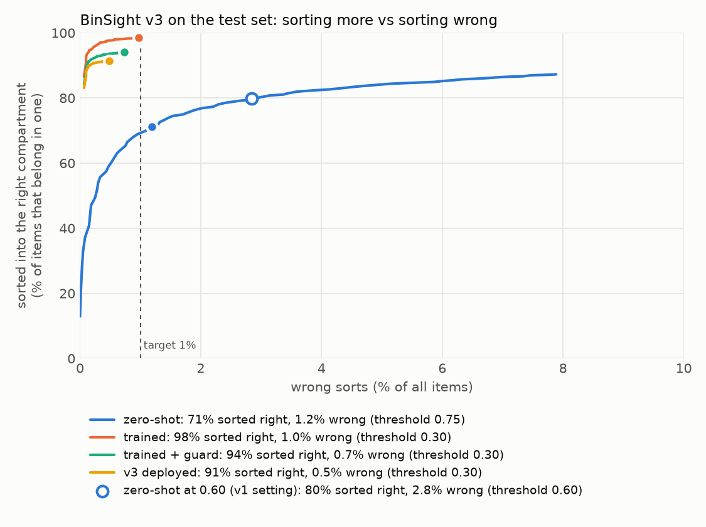
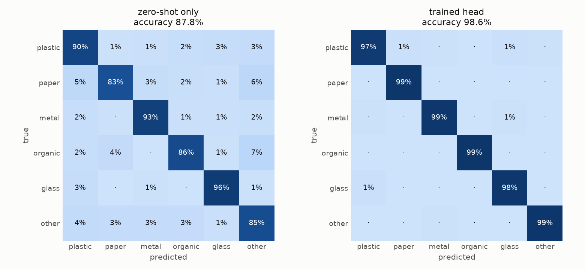

# BinSight accuracy report

Backbone `google/siglip2-so400m-patch16-256` (frozen) + trained head (MLP, 512 hidden), trained 2026-11-05T18:52:48. Test set: 3945 held-out images never used for training, model selection, calibration or threshold choice.

## Summary

- **Deployed system** (trained head + zero-shot guard + agreement, threshold 0.30): puts **0.8%** of items in the wrong compartment (95% CI 0.6–1.1%) and sorts **95.0%** of the items that belong in a compartment into the right one; everything else goes to UNSURE.
- **v1 zero-shot** at its 0.60 threshold: 5.7% wrong sorts (CI 5.0–6.4%), 78.6% of sortable items sorted right.
- 5-class accuracy: trained **98.7%** (CI 98.3–99.0%) vs zero-shot 82.5% (CI 81.3–83.7%).

Wrong sorts are what matter for a bin: one wrong item contaminates a compartment, while an UNSURE only costs a manual sort. The threshold was chosen on the validation split as the lowest one keeping wrong sorts at or below 1.0%.

## Results on the test set

| System | Threshold | Accuracy | Macro-F1 | Wrong sorts | Sortable sorted right | Auto-sorted | UNSURE | ECE |
| --- | --- | --- | --- | --- | --- | --- | --- | --- |
| v1 zero-shot | 0.60 | 82.5% | 0.802 | 5.7% | 78.6% | 45.6% | 54.4% | 0.095 |
| zero-shot, tuned threshold | 0.87 | 82.5% | 0.802 | 1.1% | 57.7% | 30.4% | 69.6% | 0.095 |
| trained head | 0.30 | 98.7% | 0.985 | 1.2% | 99.1% | 51.4% | 48.6% | 0.002 |
| trained + guard | 0.30 | 98.7% | 0.985 | 1.1% | 97.8% | 50.7% | 49.3% | 0.002 |
| trained + guard + agreement (deployed) | 0.30 | 98.7% | 0.985 | 0.8% | 95.0% | 49.0% | 51.0% | 0.002 |

Accuracy and macro-F1 use the top class over all five classes (no UNSURE). Wrong sorts, auto-sorted and UNSURE are shares of all test items after routing; an out-of-scope item ('other') auto-sorted into any compartment counts as a wrong sort. 'Sortable sorted right' is the share of plastic/paper/metal/organic items that reached the right compartment; auto-sorted can be at most 50.7% here because the rest of the test set is 'other'. ECE is expected calibration error of the confidence (lower is better).

## Per class (deployed system)

| Class | Precision | Recall | F1 | Test images |
| --- | --- | --- | --- | --- |
| plastic | 0.956 | 0.982 | 0.969 | 556 |
| paper | 0.988 | 0.995 | 0.991 | 816 |
| metal | 0.981 | 0.989 | 0.985 | 358 |
| organic | 0.985 | 0.996 | 0.991 | 272 |
| other | 0.997 | 0.983 | 0.990 | 1943 |

Compartment contamination (share of auto-sorted items that do not belong there):

| Compartment | v1 zero-shot | Deployed |
| --- | --- | --- |
| METAL | 18.6% | 2.0% |
| ORGANIC | 19.9% | 0.0% |
| PAPER | 1.4% | 0.8% |
| PLASTIC | 16.3% | 3.5% |

## Per source dataset (5-class accuracy)

| Source | Test images | v1 zero-shot | Trained |
| --- | --- | --- | --- |
| `omasteam/waste-garbage-management-dataset` | 2732 | 82.1% | 98.9% |
| `garythung/trashnet` | 294 | 87.4% | 98.6% |
| `viola77data/recycling-dataset` | 266 | 91.4% | 99.6% |
| `Tatyr2210/waste-classification-vit` | 653 | 78.4% | 97.5% |

## Photos from an unseen source

The test set above shares photographers, cameras and backgrounds with training. This harder test trains without one whole dataset and tests on all of it, which is closer to a new webcam on a new campus. Same recipe and settings as deployed.

| Held-out dataset | Images | Trained accuracy | Trained wrong sorts | v1 zero-shot accuracy | v1 wrong sorts |
| --- | --- | --- | --- | --- | --- |
| `omasteam/waste-garbage-management-dataset` | 18403 | 91.3% | 1.5% | 81.4% | 5.5% |
| `garythung/trashnet` | 1824 | 98.4% | 0.9% | 88.2% | 4.1% |
| `viola77data/recycling-dataset` | 1848 | 82.8% | 1.8% | 87.9% | 4.1% |
| `Tatyr2210/waste-classification-vit` | 4225 | 88.8% | 3.1% | 79.8% | 7.9% |

What this found (history, measured with three datasets before RealWaste was added): plastic in the two larger datasets is mostly bottles, so a head trained without the recycling-dataset mistook soft plastics (bags, wrappers) and hard plastic containers for paper or 'other', confidently: 12.0% wrong sorts on it. Zero-shot SigLIP2 knows what a wrapper is. Requiring the trained head and zero-shot to agree cut that to 2.2% but sent much of the paper to UNSURE, so agreement is waived when the head is at least 99% sure (2.7%). Both choices were made on validation data and this unseen-dataset test, never on the main test set. On the main test set now: sortable items sorted right 97.8% without these rules, 95.0% with them.

## Organic safety

Glass or plastic in food waste can hurt animals that eat it, so ORGANIC is stricter than the other compartments: zero-shot must always agree, and the trained head needs 0.98 confidence. With only the usual rules, 3 non-organic test items reached ORGANIC: green glass ornaments shaped like beans (both models were fooled), a burlap sack covered in grass, and a plastic item; validation had none, so it could not be used to choose the bar. The 0.98 bar was therefore set as a safety policy after seeing those test items. It stops all three, but because the test set informed it, the test result for ORGANIC leaks is not an independent measurement. Cost: about 2-3% of organic items go to UNSURE.

## Calibration

Softmax temperature 0.46, fitted on validation. Test ECE 0.102 before -> 0.002 after. Calibrated confidences make the threshold mean roughly what it says.

## Data

| Source | License | Images mapped | Kept after de-dup |
| --- | --- | --- | --- |
| `omasteam/waste-garbage-management-dataset` | MIT | 18815 | 18403 |
| `garythung/trashnet` | MIT | 4780 | 1824 |
| `viola77data/recycling-dataset` | Apache-2.0 | 1952 | 1848 |
| `Tatyr2210/waste-classification-vit` | MIT upload of RealWaste (CC BY 4.0) | 4268 | 4225 |

- Labels were mapped to the five classes in `config.yaml`; mixed labels (generic 'trash', takeaway cups, disposable plates, paper towels, polystyrene) were dropped rather than guessed.
- Near-duplicates (cosine >= 0.985 between embeddings, or identical image hash) were merged before splitting, so no image leaks between train and test: 3509 duplicate links in 2884 groups; 6 groups whose copies had different labels (15 images) were dropped.
- Stratified 70% / 15% / 15% train / val / test split (seed 0). Training also used 2 augmented views per image (crop, flip, rotation, colour, blur).

| Split | plastic | paper | metal | organic | other |
| --- | --- | --- | --- | --- | --- |
| train | 2593 | 3806 | 1671 | 1272 | 9068 |
| val | 556 | 816 | 358 | 272 | 1943 |
| test | 556 | 816 | 358 | 272 | 1943 |

## Method

1. Every image is embedded once by the frozen SigLIP2 vision encoder (fp16 on MPS).
2. A small head (grid over linear / MLP, learning rate, weight decay; best validation macro-F1 kept) is trained on those embeddings with class-balanced cross-entropy.
3. A softmax temperature is fitted on validation.
4. The zero-shot prompts from v1 still run on the same embedding as a guard: if they say 'other' with probability >= 0.5, the item goes to UNSURE. This covers things the datasets have no pictures of (hands, faces, an empty tray, phones).
5. Agreement: the item is auto-sorted only if the trained head and the zero-shot prompts pick the same class, or the head is at least 99% sure; for organic, agreement is always required and the head needs a higher confidence (see the unseen-source test and organic safety).
6. The UNSURE threshold is the lowest one meeting the wrong-sort target on validation.

Validation grid:

| Hidden | LR | Weight decay | Val macro-F1 | Best epoch |
| --- | --- | --- | --- | --- |
| 0 | 0.001 | 0.0001 | 0.9745 | 38 |
| 0 | 0.001 | 0.01 | 0.9745 | 37 |
| 0 | 0.0003 | 0.0001 | 0.9565 | 34 |
| 0 | 0.0003 | 0.01 | 0.9565 | 35 |
| 512 | 0.001 | 0.0001 | 0.9861 | 30 |
| 512 | 0.001 | 0.01 | 0.9858 | 30 |
| 512 | 0.0003 | 0.0001 | 0.9824 | 24 |
| 512 | 0.0003 | 0.01 | 0.9824 | 24 |

Weight decay made no measurable difference at these settings; the hidden layer and learning rate did.

## Limitations

- The test images come from the same web datasets as the training images: mostly single items, well lit, plain backgrounds. A webcam over a real tray will look different, so expect lower accuracy live; the threshold can be raised with `+`.
- De-duplication removes copies, not different photos of the same object; such near-twins can still sit on both sides of the split and flatter these numbers.
- 'other' in the data is glass, batteries, clothes and shoes only. Hands, faces, phones and an empty tray rely on the zero-shot guard, which this test set does not measure.
- Class mapping is a policy choice (e.g. cardboard is paper, soft plastics are plastic, glass is UNSURE because the bin has no glass compartment).
