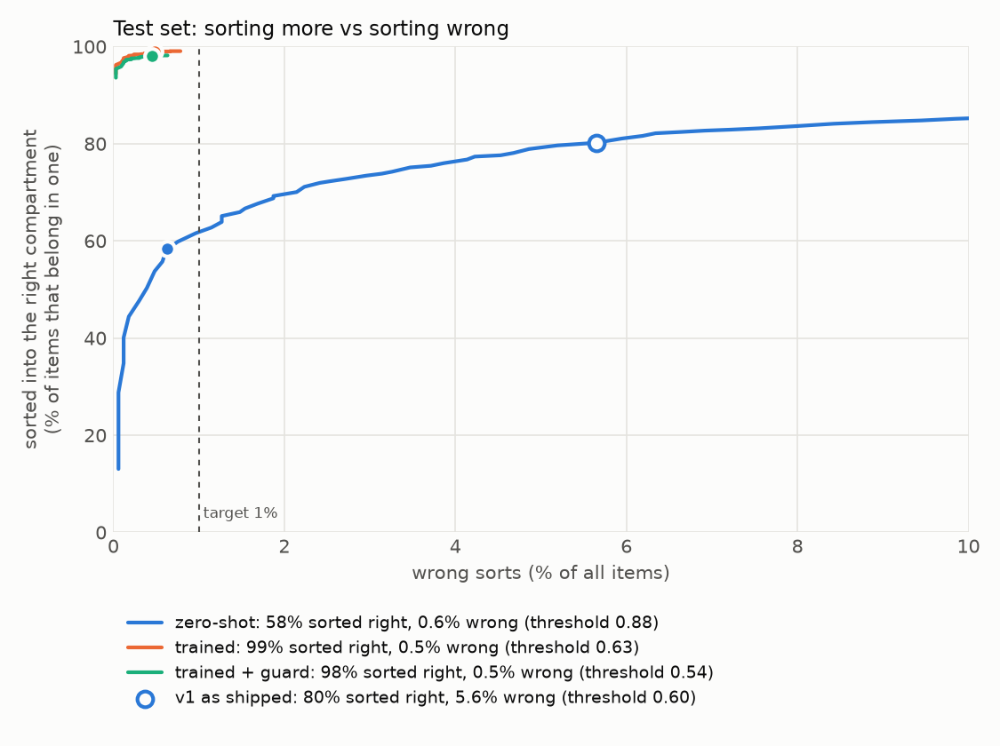
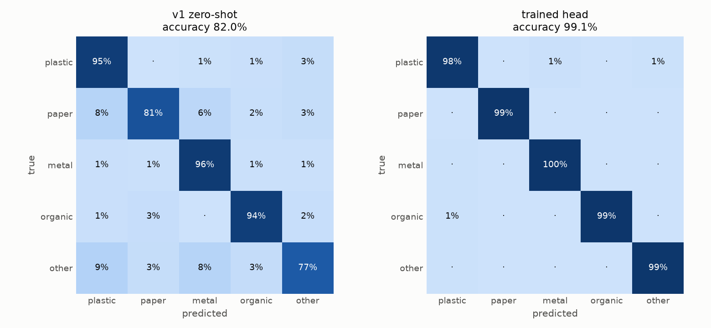

# BinSight accuracy report

Backbone `google/siglip2-so400m-patch16-256` (frozen) + trained head (MLP, 512 hidden), trained 2026-10-28T17:22:30. Test set: 3312 held-out images never used for training, model selection, calibration or threshold choice.

## Summary

- **Deployed system** (trained head + zero-shot guard, threshold 0.54): puts **0.5%** of items in the wrong compartment (95% CI 0.2–0.7%) and sorts **98.1%** of the items that belong in a compartment into the right one; everything else goes to UNSURE.
- **v1 zero-shot** at its 0.60 threshold: 5.6% wrong sorts (CI 4.9–6.4%), 80.2% of sortable items sorted right.
- 5-class accuracy: trained **99.1%** (CI 98.8–99.4%) vs zero-shot 82.0% (CI 80.6–83.2%).

Wrong sorts are what matter for a bin: one wrong item contaminates a compartment, while an UNSURE only costs a manual sort. The threshold was chosen on the validation split as the lowest one keeping wrong sorts at or below 1.0%.

## Results on the test set

| System | Threshold | Accuracy | Macro-F1 | Wrong sorts | Sortable sorted right | Auto-sorted | UNSURE | ECE |
| --- | --- | --- | --- | --- | --- | --- | --- | --- |
| v1 zero-shot | 0.60 | 82.0% | 0.785 | 5.6% | 80.2% | 41.5% | 58.5% | 0.100 |
| zero-shot, tuned threshold | 0.88 | 82.0% | 0.785 | 0.6% | 58.4% | 26.7% | 73.3% | 0.100 |
| trained head | 0.63 | 99.1% | 0.987 | 0.5% | 98.9% | 44.7% | 55.3% | 0.006 |
| trained + guard (deployed) | 0.54 | 99.1% | 0.987 | 0.5% | 98.1% | 44.3% | 55.7% | 0.006 |

Accuracy and macro-F1 use the top class over all five classes (no UNSURE). Wrong sorts, auto-sorted and UNSURE are shares of all test items after routing; an out-of-scope item ('other') auto-sorted into any compartment counts as a wrong sort. 'Sortable sorted right' is the share of plastic/paper/metal/organic items that reached the right compartment; auto-sorted can be at most 44.7% here because the rest of the test set is 'other'. ECE is expected calibration error of the confidence (lower is better).

## Per class (deployed system)

| Class | Precision | Recall | F1 | Test images |
| --- | --- | --- | --- | --- |
| plastic | 0.972 | 0.981 | 0.976 | 418 |
| paper | 0.997 | 0.994 | 0.996 | 672 |
| metal | 0.960 | 0.996 | 0.978 | 240 |
| organic | 0.987 | 0.993 | 0.990 | 149 |
| other | 0.998 | 0.992 | 0.995 | 1833 |

Compartment contamination (share of auto-sorted items that do not belong there):

| Compartment | v1 zero-shot | Deployed |
| --- | --- | --- |
| METAL | 26.1% | 1.6% |
| ORGANIC | 15.9% | 0.7% |
| PAPER | 2.2% | 0.2% |
| PLASTIC | 17.5% | 2.2% |

## Per source dataset (5-class accuracy)

| Source | Test images | v1 zero-shot | Trained |
| --- | --- | --- | --- |
| `omasteam/waste-garbage-management-dataset` | 2758 | 80.7% | 99.5% |
| `garythung/trashnet` | 276 | 88.8% | 98.6% |
| `viola77data/recycling-dataset` | 278 | 88.1% | 96.0% |

## Calibration

Softmax temperature 0.41, fitted on validation. Test ECE 0.150 before -> 0.006 after. Calibrated confidences make the threshold mean roughly what it says.

## Data

| Source | License | Images mapped | Kept after de-dup |
| --- | --- | --- | --- |
| `omasteam/waste-garbage-management-dataset` | MIT | 18815 | 18403 |
| `garythung/trashnet` | MIT | 4780 | 1824 |
| `viola77data/recycling-dataset` | Apache-2.0 | 1952 | 1848 |

- Labels were mapped to the five classes in `config.yaml`; mixed labels (generic 'trash', takeaway cups, disposable plates, paper towels, polystyrene) were dropped rather than guessed.
- Near-duplicates (cosine >= 0.985 between embeddings, or identical image hash) were merged before splitting, so no image leaks between train and test: 3466 duplicate links in 2851 groups; 6 groups whose copies had different labels (15 images) were dropped.
- Stratified 70% / 15% / 15% train / val / test split (seed 0). Training also used 2 augmented views per image (crop, flip, rotation, colour, blur).

| Split | plastic | paper | metal | organic | other |
| --- | --- | --- | --- | --- | --- |
| train | 1948 | 3135 | 1118 | 694 | 8556 |
| val | 418 | 672 | 240 | 149 | 1833 |
| test | 418 | 672 | 240 | 149 | 1833 |

## Method

1. Every image is embedded once by the frozen SigLIP2 vision encoder (fp16 on MPS).
2. A small head (grid over linear / MLP, learning rate, weight decay; best validation macro-F1 kept) is trained on those embeddings with class-balanced cross-entropy.
3. A softmax temperature is fitted on validation.
4. The zero-shot prompts from v1 still run on the same embedding as a guard: if they say 'other' with probability >= 0.5, the item goes to UNSURE. This covers things the datasets have no pictures of (hands, faces, an empty tray, phones).
5. The UNSURE threshold is the lowest one meeting the wrong-sort target on validation.

Validation grid:

| Hidden | LR | Weight decay | Val macro-F1 | Best epoch |
| --- | --- | --- | --- | --- |
| 0 | 0.001 | 0.0001 | 0.9686 | 26 |
| 0 | 0.001 | 0.01 | 0.9686 | 25 |
| 0 | 0.0003 | 0.0001 | 0.9498 | 31 |
| 0 | 0.0003 | 0.01 | 0.9498 | 31 |
| 512 | 0.001 | 0.0001 | 0.9800 | 29 |
| 512 | 0.001 | 0.01 | 0.9800 | 29 |
| 512 | 0.0003 | 0.0001 | 0.9772 | 26 |
| 512 | 0.0003 | 0.01 | 0.9772 | 26 |

Weight decay made no measurable difference at these settings; the hidden layer and learning rate did.

## Limitations

- The test images come from the same web datasets as the training images: mostly single items, well lit, plain backgrounds. A webcam over a real tray will look different, so expect lower accuracy live; the threshold can be raised with `+`.
- De-duplication removes copies, not different photos of the same object; such near-twins can still sit on both sides of the split and flatter these numbers.
- 'other' in the data is glass, batteries, clothes and shoes only. Hands, faces, phones and an empty tray rely on the zero-shot guard, which this test set does not measure.
- Class mapping is a policy choice (e.g. cardboard is paper, soft plastics are plastic, glass is UNSURE because the bin has no glass compartment).
